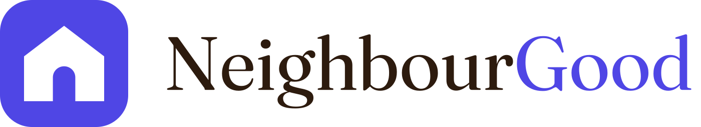

<h1>
  <picture>
    <source media="(prefers-color-scheme: dark)" srcset="brand/svg/logo-dark.svg">
    
  </picture>
</h1>

**Share with your neighbours on ordinary days. Help each other when things go wrong, even without internet.**

NeighbourGood is a free, self-hostable web app for neighbourhoods. People lend each other tools and equipment, offer skills, organise local events and get to know each other. When a flood, storm or power cut hits, the same community switches to crisis mode with one action and coordinates help, even over Bluetooth when the internet is down.

v2.7.0 · 12 languages · [GPL-3.0](LICENSE)

[What it does](#what-it-does) · [Everyday: Blue Sky](#everyday-blue-sky) · [Crisis: Red Sky](#crisis-red-sky) · [Telegram](#use-it-from-telegram) · [Connected communities](#connected-communities) · [Get started](#get-started) · [Documentation](#documentation) · [Roadmap](#roadmap) · [Contributing](#contributing)

## What it does

Most neighbourhoods already have what they need: a drill in one cellar, a cargo bike in a courtyard, someone who fixes bikes, someone who speaks Arabic. It's just not visible. NeighbourGood makes it visible and easy to share, and it builds the trust and the contacts that matter when a crisis comes.

The app has two states:

- **Blue Sky** is everyday sharing and community life.
- **Red Sky** is crisis coordination: emergency requests, offers and pings, sorted by urgency.

## Everyday: Blue Sky

- **Lend and borrow.** List things you can lend (tools, vehicles, electronics, furniture, …), book them for specific dates, and approve or decline requests.
- **Swap skills.** Offer what you can do (repairs, tutoring, cooking, languages) or ask for help.
- **Local events.** Repair cafés, workshops, seed swaps, street parties, with RSVP and attendee limits.
- **Messages.** Write directly to other members of your community.
- **Trust.** Reviews after each loan, reputation levels from *Newcomer* to *Pillar*, and badges such as *Reliable Borrower* or *Trusted Lender* help people decide whom to lend to.
- **Community feed and map.** See what's new nearby; guests can find communities on a public map before signing up.
- **In your language.** English, German, French, Spanish, Dutch, Greek, Ukrainian, Arabic, Farsi, Swahili, Indonesian and Sundanese, with right-to-left layouts for Arabic and Farsi.
- **Works on phones.** Install it like an app; browsing and requests keep working when the connection drops and are sent once you're back online.


## Crisis: Red Sky

A community switches to Red Sky when its admin turns it on or when 60 % of members vote for it. An instance admin can also switch every community at once. The app then changes its focus:

- **Emergency tickets.** Members post *requests* ("we need drinking water"), *offers* ("generator available") and *emergency pings*. Each one has an urgency level written out as CRITICAL, HIGH, MEDIUM or LOW, so nothing depends on telling colours apart.
- **Neighbourhood leaders** triage and assign tickets.
- **A screen you can read under stress.** Red Sky is always dark, uses red as its only colour, and leaves out heavy images. The Emergency page opens with the connection status and one large *Send emergency ping* button.
- **No internet? Bluetooth mesh.** With the free [BitChat](https://github.com/permissionlesstech/bitchat) app on nearby phones, tickets travel phone to phone over Bluetooth and are synced to the server when the internet is back.

### Red Sky in action

<p align="center">
  
</p>

1. **Ping without internet.** A household whose cellar is flooding taps *Send emergency ping*. There's no internet, so the ticket goes out over Bluetooth.
2. **Hops phone to phone.** Nearby phones running BitChat pass the signed message on, up to 7 hops (about 700 m), until it reaches the neighbourhood coordinator.
3. **Triaged by urgency.** The ticket lands at the top of every Emergency list in reach as CRITICAL, above high, medium and offer items.
4. **A neighbour helps.** Felix replies over the same mesh, the ticket moves to *In progress*, and it's marked *Resolved* when the sandbags arrive. Once the internet is back, everything syncs to the server without duplicates.

The mesh works in Chrome and Edge (desktop and Android). How it works and how to set it up: [docs/mesh-networking.md](docs/mesh-networking.md).

## Use it from Telegram

Many neighbours already live in Telegram, so NeighbourGood comes to them there once the instance admin has connected a bot.

- **Notifications in your chat.** Link your account under **Settings → Telegram** and get new messages, booking requests and updates, and crisis alerts as Telegram messages.
- **Your community's group chat.** A community admin adds the bot to the group. New resources, skills, members and, in Red Sky, every emergency ticket are posted there automatically. Commands like `/lending Anna` or `/skills Omar` show what a neighbour offers.
- **Just ask.** If the instance has AI enabled, write to the bot in plain language: *"Does anyone have a ladder?"*, *"Who can help with plumbing?"*. During a crisis: *"What's happening?"* or *"We need food, the power is out"*, which creates an emergency request after you confirm it.

The bot never acts without your confirmation, never shares private details such as emails, and only sees your own communities. Setup for admins: [docs/telegram-setup.md](docs/telegram-setup.md).

## Connected communities

Every NeighbourGood server is independent: your data stays with whoever runs your instance. Instances can still find each other and stay in touch. They list each other in a directory, show each other's shared items and skills, and send **verified Red Sky alerts** across instances, so a neighbouring town learns about a crisis quickly.

Members can download all their data at any time and delete their account, which anonymises it.

## Get started

**Try it or run it for your neighbourhood.** On a Linux server or your computer:

```bash
curl -fsSL https://raw.githubusercontent.com/neighbourgood/neighbourgood/main/install.sh | bash
```

The installer uses Docker when it's available, generates a secret key and starts everything. Then open http://localhost:3800, sign up, and the onboarding wizard helps you create your community. Invite your neighbours with an invite link from the community page.

A small rented server (1 CPU, 1 GB RAM, around 5 € a month) is enough for a few hundred people. For a real instance with your own domain and HTTPS, follow **[docs/self-hosting.md](docs/self-hosting.md)**. All settings are in [docs/configuration.md](docs/configuration.md).

## Documentation

| | |
|---|---|
| [Self-hosting](docs/self-hosting.md) | Install with Docker, updates, reverse proxy (nginx/Caddy), backups, local AI |
| [Configuration](docs/configuration.md) | All `NG_` settings |
| [Telegram setup](docs/telegram-setup.md) · [Telegram assistant](docs/telegram-agent.md) | Connect the bot; customise its tone and abilities |
| [Mesh networking](docs/mesh-networking.md) | Offline crisis communication over Bluetooth |
| [Brand and design](docs/design.md) | Logo, colours, typefaces; brand kit in [`brand/`](brand/) |
| [Development](docs/development.md) | Tech stack, local setup, tests, project structure |
| [API reference](docs/api.md) | All endpoints; interactive docs at `/docs` on a running server |
| [Roadmap](docs/roadmap.md) | What's done and what's next |
| [Changelog](CHANGELOG.md) · [Security policy](SECURITY.md) | Release history; how to report vulnerabilities |

## Roadmap

NeighbourGood is in active use and development. Next up:

- An admin dashboard with usage analytics
- Signal and Matrix alongside Telegram
- Notification emails in each member's language, and more languages
- Audit logging, automated encrypted backups and automated security checks

Full list: [docs/roadmap.md](docs/roadmap.md).

## Contributing

Help is welcome, and not only with code: translations, testing with a real neighbourhood, design and documentation all count. Please read [CONTRIBUTING.md](CONTRIBUTING.md) and the [Code of Conduct](CODE_OF_CONDUCT.md). Developers start with [docs/development.md](docs/development.md); code conventions are in [CLAUDE.md](CLAUDE.md).

## License

NeighbourGood is free software under the [GNU General Public License v3.0](LICENSE). The brand kit's typefaces (Fraunces, Inter, JetBrains Mono) are under the SIL Open Font License.
